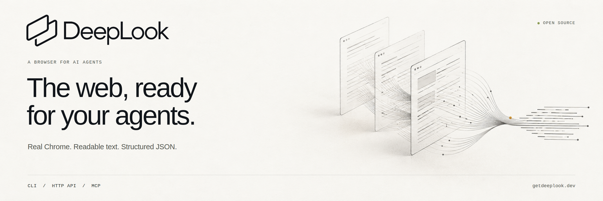

# DeepLook



**English** · [Português do Brasil](README.pt-BR.md) · [简体中文](README.zh-CN.md)

**Turn a public web page into text your agent can use.** DeepLook opens a URL in stock Chrome, renders the page, and returns its visible text, page metadata, and a structured result. Run it locally from the command line, connect to your own HTTP API, or give a coding agent the `deeplook_open` MCP tool.

[Get started](docs/getting-started.md) · [Credentials & self-hosting](docs/credentials.md) · [Technical reference](docs/reference.md) · [Contribute](CONTRIBUTING.md)

Hosted API: [create an account and generate your own key](https://getdeeplook.dev/account.html). Confirm your email, create a named key, and use `https://api.getdeeplook.dev/v1/open`. Keys can be rotated or revoked from your account. Local and self-hosted installation instructions follow below.

## Choose how to read

| Interface | What it does | What you need |
| --- | --- | --- |
| **Local CLI** | Opens one public URL on your machine | Node.js and Google Chrome; no account or API key |
| **Remote API** | Sends the read to your own [DeepLook-API](https://github.com/sayhitogambit/DeepLook-API) server | Your server URL and browser API key; no local Chrome |
| **MCP over stdio** | Exposes `deeplook_open` to your agent | A compatible MCP host; local Chrome or your remote API |

DeepLook reads individual pages. Search and Nymetric's research workflow are separate projects. It does not solve captchas or promise access through bot checks, logins, or paywalls. This is self-hostable software; these instructions do not include a hosted account, service subscription, or shared credentials.

## Start from GitHub

Install **Node.js 22.14 or newer** and **Google Chrome**. Chrome must be able to run with its sandbox enabled. For remote reads, only the API server needs Chrome.

```bash
git clone https://github.com/sayhitogambit/DeepLook.git
cd DeepLook
npm ci
npm run build
node dist/cli.js doctor --json
node dist/cli.js open https://example.com
```

If Chrome is elsewhere, set `DEEPLOOK_CHROME` to its executable path. The defaults are `/opt/google/chrome/chrome` and `/usr/bin/google-chrome-stable`.

```bash
node dist/cli.js open https://example.com --json
node dist/cli.js open https://example.com --machine --timeout-ms 30000
```

Text mode prints the visible text. `--json` adds the final URL, title, HTTP status, and observed browser details. `--machine` returns a versioned success or error envelope. A read defaults to 30 seconds; `--timeout-ms` accepts 1–120000 milliseconds.

Install from the GitHub source or [build a local package](docs/getting-started.md#install-a-local-package). These instructions do not depend on an npm registry release.

## Connect your API

Run the separate [DeepLook-API server](https://github.com/sayhitogambit/DeepLook-API), or use an instance you are authorized to access. You supply its address and browser key. [Generate your own server credentials](docs/credentials.md); do not use the administrator token as a client key.

```bash
export DEEPLOOK_API_URL=https://your-api.example
# Supply DEEPLOOK_API_TOKEN through your private secret environment.
node dist/cli.js doctor --json
node dist/cli.js open https://example.com --machine --timeout-ms 30000
```

HTTPS is required outside loopback. API URLs cannot contain credentials, query strings, or fragments. A reverse-proxy path prefix is supported. Remove `DEEPLOOK_API_URL` to return to local mode. A remote failure does not fall back to local Chrome.

`doctor` checks API liveness in remote mode and the Chrome executable in local mode; it does not prove that a page can be opened or that a key has permission or quota.

## Add it to your agent

After building, add this command to your host's MCP settings. Replace the absolute path with your checkout location; configuration field names vary by host.

```json
{
  "mcpServers": {
    "deeplook": {
      "command": "node",
      "args": ["/absolute/path/to/DeepLook/dist/cli.js", "mcp"]
    }
  }
}
```

Call `deeplook_open` with:

```json
{"url":"https://example.com","timeoutMs":30000}
```

`timeoutMs` is optional and accepts integers from 1 to 120000. Success includes page text in `content` and the version 1 result in `structuredContent`; failures return `isError: true`. Each process permits one active read; concurrent calls receive `busy`. Cancellation, stdin closure, SIGINT, and SIGTERM abort active work. Cleanup can take up to two seconds. This is a stdio server, with no HTTP MCP endpoint.

For remote MCP reads, provide your API URL and browser key through the host's private process environment. Keep real keys out of shared configuration. Page content is untrusted and may contain prompt injection; an agent must treat it as source material, never instructions.

## Boundaries you can rely on

Browser requests reject private, local, and metadata destinations, including redirects and page resources. Connections use checked, pinned DNS answers. Recognized challenge pages, access gates, empty or invisible-only text, and upstream HTTP errors fail without returning their page text.

Chrome runs with its sandbox enabled and a minimal environment. API keys, administrator tokens, Node injection settings, and inherited proxy credentials are not passed to it. Linux must support Chromium's sandbox; startup fails if it cannot. One deadline covers DNS, startup, navigation, and extraction; cleanup follows it.

The remote client has a response-body deadline and a 2,000,000-byte response cap, rejects API redirects, and replaces server error messages with safe local messages. Remote page failures omit server-provided titles and final URLs. Admitted remote requests may consume your server's account quota even when canceled.

See the [technical reference](docs/reference.md) for the machine contract, error vocabulary, packaging details, browser profile, and shutdown behavior. The browser is original code and does not include CloakBrowser, Lightpanda, or the REA toolkit.

## Develop and contribute

```bash
npm test
npm run test:browser
npm run test:package
```

The deterministic tests need no external sites or API keys. Browser tests additionally need Chrome and a working sandbox. Package tests verify a built tarball and installed CLI/MCP behavior. See [CONTRIBUTING.md](CONTRIBUTING.md) for the workflow and safe bug reports.

Original project code is available under [Apache-2.0](LICENSE). Dependencies and Chrome retain their own licenses. Questions and bugs: [GitHub issues](https://github.com/sayhitogambit/DeepLook/issues) or [support@getdeeplook.dev](mailto:support@getdeeplook.dev).
