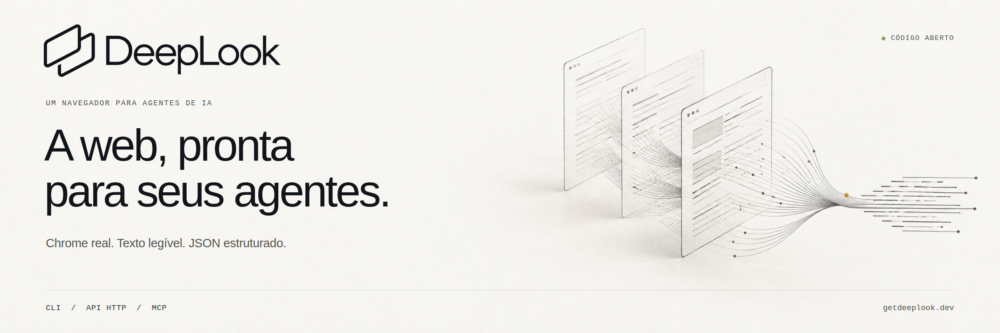

# DeepLook



[English](README.md) · **Português do Brasil** · [简体中文](README.zh-CN.md)

**Transforme uma página pública em texto que seu agente pode usar.** O DeepLook abre uma URL no Chrome padrão, renderiza a página e retorna seu texto visível, metadados e um resultado estruturado. Use pela linha de comando, conecte sua própria API HTTP ou disponibilize a ferramenta MCP `deeplook_open` para um agente de programação.

[Primeiros passos](docs/getting-started.md) · [Credenciais e hospedagem própria](docs/credentials.md) · [Referência técnica](docs/reference.md) · [Contribuir](CONTRIBUTING.md) — guias detalhados em inglês.

## Escolha como ler

| Interface | O que faz | O que você precisa |
| --- | --- | --- |
| **CLI local** | Abre uma URL pública na sua máquina | Node.js e Google Chrome; sem conta ou chave de API |
| **API remota** | Envia a leitura ao seu servidor [DeepLook-API](https://github.com/sayhitogambit/DeepLook-API) | URL e chave de acesso do seu servidor; sem Chrome local |
| **MCP por stdio** | Disponibiliza `deeplook_open` ao seu agente | Cliente MCP compatível; Chrome local ou sua API remota |

O DeepLook lê páginas individuais. A busca e o fluxo de pesquisa do Nymetric são projetos separados. Ele não resolve captchas nem promete acesso através de verificações de bot, login ou paywall. Este software pode ser hospedado por você; as instruções não incluem conta hospedada, assinatura de serviço ou credenciais compartilhadas.

## Comece pelo GitHub

Instale **Node.js 22.14 ou superior** e **Google Chrome**. O Chrome precisa conseguir executar com sandbox habilitado. Para leituras remotas, apenas o servidor da API precisa de Chrome.

```bash
git clone https://github.com/sayhitogambit/DeepLook.git
cd DeepLook
npm ci
npm run build
node dist/cli.js doctor --json
node dist/cli.js open https://example.com
```

Se o Chrome estiver em outro local, defina `DEEPLOOK_CHROME` com o caminho do executável. Os padrões são `/opt/google/chrome/chrome` e `/usr/bin/google-chrome-stable`.

```bash
node dist/cli.js open https://example.com --json
node dist/cli.js open https://example.com --machine --timeout-ms 30000
```

O modo texto imprime o texto visível. `--json` inclui URL final, título, status HTTP e detalhes observados do navegador. `--machine` retorna um envelope versionado de sucesso ou erro. O prazo padrão de uma leitura é 30 segundos; `--timeout-ms` aceita de 1 a 120000 milissegundos.

Instale pelo código-fonte do GitHub ou [gere um pacote local](docs/getting-started.md#install-a-local-package). Estas instruções não dependem de publicação no registro npm.

## Conecte sua API

Execute o [servidor DeepLook-API](https://github.com/sayhitogambit/DeepLook-API) separado ou use uma instância à qual você tenha acesso autorizado. Você fornece o endereço e a chave de acesso ao navegador. [Gere suas próprias credenciais de servidor](docs/credentials.md); não use o token de administrador como chave do cliente.

```bash
export DEEPLOOK_API_URL=https://your-api.example
# Forneça DEEPLOOK_API_TOKEN pelo seu ambiente privado de segredos.
node dist/cli.js doctor --json
node dist/cli.js open https://example.com --machine --timeout-ms 30000
```

HTTPS é obrigatório fora de loopback. A URL da API não pode conter credenciais, parâmetros de consulta ou fragmentos. Um prefixo de caminho de proxy reverso é permitido. Remova `DEEPLOOK_API_URL` para voltar ao modo local. Falhas remotas não acionam o Chrome local.

O `doctor` verifica se a API responde no modo remoto e se o executável do Chrome responde no modo local; ele não comprova que uma página pode ser aberta nem que uma chave tem permissão ou cota.

## Adicione ao seu agente

Após compilar, adicione este comando às configurações MCP do cliente. Substitua o caminho absoluto pelo local do seu repositório; os nomes dos campos de configuração variam entre clientes.

```json
{
  "mcpServers": {
    "deeplook": {
      "command": "node",
      "args": ["/absolute/path/to/DeepLook/dist/cli.js", "mcp"]
    }
  }
}
```

Chame `deeplook_open` com:

```json
{"url":"https://example.com","timeoutMs":30000}
```

`timeoutMs` é opcional e aceita inteiros de 1 a 120000. O sucesso inclui texto em `content` e o resultado versão 1 em `structuredContent`; falhas retornam `isError: true`. Cada processo permite uma leitura ativa; chamadas simultâneas recebem `busy`. Cancelamento, fechamento de stdin, SIGINT e SIGTERM interrompem o trabalho ativo. A limpeza pode levar até dois segundos. Este é um servidor stdio, sem endpoint HTTP de MCP.

Para leituras MCP remotas, forneça a URL da API e a chave de acesso pelo ambiente privado do processo do cliente. Mantenha chaves reais fora de configurações compartilhadas. O conteúdo da página não é confiável e pode conter injeção de prompt; o agente deve tratá-lo como fonte, nunca como instruções.

## Limites do funcionamento

As requisições do navegador recusam destinos privados, locais e de metadados, inclusive em redirecionamentos e recursos da página. As conexões usam respostas DNS conferidas e fixadas. Desafios reconhecidos, barreiras de acesso, texto vazio ou totalmente invisível e erros HTTP do site resultam em falha sem retornar o texto dessas páginas.

O Chrome executa com sandbox habilitado e ambiente mínimo. Chaves de API, tokens de administrador, opções de injeção de código do Node e credenciais de proxy herdadas não são repassados a ele. O Linux precisa permitir o sandbox do Chromium; caso contrário, a inicialização falha. Um único prazo cobre DNS, inicialização, navegação e extração; a limpeza ocorre depois dele.

O cliente remoto tem prazo para leitura do corpo e limite de resposta de 2.000.000 bytes, recusa redirecionamentos da API e substitui mensagens de erro do servidor por mensagens locais seguras. Falhas remotas de página omitem títulos e URLs finais vindos do servidor. Requisições remotas admitidas podem consumir a cota de conta do seu servidor mesmo quando canceladas.

Consulte a [referência técnica](docs/reference.md) para o contrato de máquina, os erros, o empacotamento, o perfil do navegador e o encerramento. O código do navegador é original e não inclui CloakBrowser, Lightpanda nem o conjunto de ferramentas REA.

## Desenvolva e contribua

```bash
npm test
npm run test:browser
npm run test:package
```

Os testes determinísticos não exigem sites externos ou chaves de API. Os testes de navegador também precisam de Chrome e sandbox funcionando. Os testes de pacote verificam o arquivo gerado e o comportamento do CLI/MCP instalado. Veja o fluxo de contribuição e os relatos seguros de problemas em [CONTRIBUTING.md](CONTRIBUTING.md).

O código original do projeto está disponível sob [Apache-2.0](LICENSE). As dependências e o Chrome mantêm suas próprias licenças. Dúvidas e problemas: [issues no GitHub](https://github.com/sayhitogambit/DeepLook/issues) ou [support@getdeeplook.dev](mailto:support@getdeeplook.dev).
