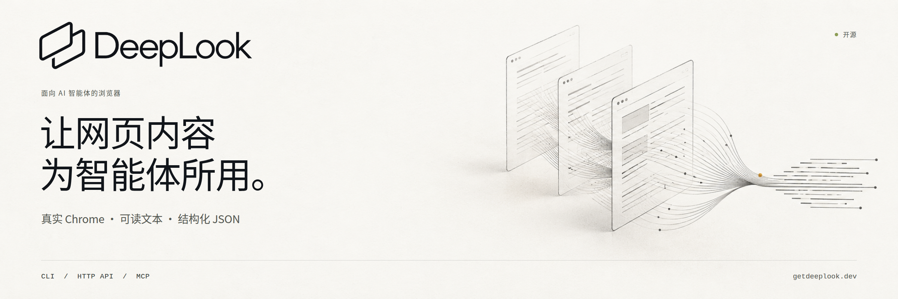

# DeepLook



[English](README.md) · [Português do Brasil](README.pt-BR.md) · **简体中文**

**将公开网页转换成智能体可用的文本。** DeepLook 使用标准版 Chrome 打开网址、渲染页面，并返回可见文本、页面元数据和结构化结果。你可以在本地使用命令行、连接自己的 HTTP API，或通过 MCP 工具 `deeplook_open` 让编程智能体读取网页。

[快速入门](docs/getting-started.md) · [凭据与自行部署](docs/credentials.md) · [技术参考](docs/reference.md) · [参与贡献](CONTRIBUTING.md) — 详细指南以英文提供。

托管 API：[注册账户并生成自己的密钥](https://getdeeplook.dev/account.html)。验证邮箱后，创建命名密钥并调用 `https://api.getdeeplook.dev/v1/open`。你可以在账户中轮换或撤销密钥。下方提供本地使用和自行部署的说明。

## 选择读取方式

| 接口 | 功能 | 所需条件 |
| --- | --- | --- |
| **本地 CLI** | 在本机打开一个公开网址 | Node.js 和 Google Chrome；无需账户或 API 密钥 |
| **远程 API** | 将读取请求发送至自己的 [DeepLook-API](https://github.com/sayhitogambit/DeepLook-API) 服务器 | 服务器地址和浏览器 API 密钥；本地无需 Chrome |
| **stdio MCP** | 向智能体提供 `deeplook_open` | 兼容的 MCP 客户端；本地 Chrome 或自己的远程 API |

DeepLook 读取单个页面。搜索和 Nymetric 的研究流程属于独立项目。它不破解验证码，也不保证能够通过机器人检测、登录或付费墙。本软件支持自行部署；这些说明不提供托管账户、服务订阅或共享凭据。

## 从 GitHub 开始

安装 **Node.js 22.14 或更高版本**和 **Google Chrome**。Chrome 必须能够启用沙箱运行。远程读取时，只有 API 服务器需要 Chrome。

```bash
git clone https://github.com/sayhitogambit/DeepLook.git
cd DeepLook
npm ci
npm run build
node dist/cli.js doctor --json
node dist/cli.js open https://example.com
```

如果 Chrome 位于其他位置，请通过 `DEEPLOOK_CHROME` 指定可执行文件路径。默认路径为 `/opt/google/chrome/chrome` 和 `/usr/bin/google-chrome-stable`。

```bash
node dist/cli.js open https://example.com --json
node dist/cli.js open https://example.com --machine --timeout-ms 30000
```

文本模式输出可见文本。`--json` 额外返回最终 URL、标题、HTTP 状态和页面观察到的浏览器信息。`--machine` 返回带版本号的成功或错误封装。默认读取时限为 30 秒；`--timeout-ms` 接受 1–120000 毫秒。

请从 GitHub 源码安装，或[生成本地安装包](docs/getting-started.md#install-a-local-package)。这些说明不依赖 npm 注册表发布。

## 连接自己的 API

运行独立的 [DeepLook-API 服务器](https://github.com/sayhitogambit/DeepLook-API)，或使用你获准访问的实例。你需要提供服务器地址和浏览器密钥。[生成自己的服务器凭据](docs/credentials.md)；不要将管理员令牌用作客户端密钥。

```bash
export DEEPLOOK_API_URL=https://your-api.example
# 请通过私有密钥环境提供 DEEPLOOK_API_TOKEN。
node dist/cli.js doctor --json
node dist/cli.js open https://example.com --machine --timeout-ms 30000
```

除回环地址外，必须使用 HTTPS。API URL 不能包含凭据、查询参数或片段标识符。支持反向代理路径前缀。移除 `DEEPLOOK_API_URL` 即可恢复本地模式。远程失败不会回退到本地 Chrome。

远程模式下，`doctor` 检查 API 是否存活；本地模式下，它检查 Chrome 可执行文件能否响应。该检查不证明页面可以打开，也不验证密钥权限或配额。

## 添加到智能体

编译完成后，将此命令添加到客户端的 MCP 设置中。请将绝对路径替换为你的仓库位置；不同客户端的配置字段可能不同。

```json
{
  "mcpServers": {
    "deeplook": {
      "command": "node",
      "args": ["/absolute/path/to/DeepLook/dist/cli.js", "mcp"]
    }
  }
}
```

使用以下参数调用 `deeplook_open`：

```json
{"url":"https://example.com","timeoutMs":30000}
```

`timeoutMs` 可选，接受 1 至 120000 的整数。成功时，`content` 包含页面文本，`structuredContent` 包含版本 1 的结果；失败时返回 `isError: true`。每个进程只允许一个正在执行的读取任务；并发调用会收到 `busy`。取消请求、关闭 stdin、SIGINT 和 SIGTERM 都会中止当前任务。清理最多可能需要两秒。这是 stdio 服务器，不提供 HTTP MCP 端点。

远程 MCP 读取需要通过客户端进程的私有环境提供 API 地址和浏览器密钥。不要将真实密钥写入共享配置。页面内容不可信，可能包含提示注入；智能体必须将其视为源材料，不能将其视为指令。

## 运行边界

浏览器请求会拒绝私有、本地及元数据地址，包括重定向目标和页面资源。连接使用经过检查并固定的 DNS 解析结果。识别到挑战页面、访问限制、空文本或完全不可见的文本，以及上游 HTTP 错误时，会返回失败且不输出这些页面的文本。

Chrome 启用沙箱运行，并仅接收最小化的环境。API 密钥、管理员令牌、Node 代码注入配置及继承的代理凭据不会传给 Chrome。Linux 必须支持 Chromium 沙箱，否则启动失败。一个统一的时限覆盖 DNS、启动、导航和提取；清理在此后进行。

远程客户端设有响应体读取时限和 2,000,000 字节的响应上限，拒绝 API 重定向，并将服务端错误消息替换为安全的本地消息。远程页面读取失败时，不返回服务端提供的标题及最终 URL。已被服务器接受的远程请求即使随后取消，也可能消耗服务器账户配额。

[技术参考](docs/reference.md)包含机器协议、错误类型、打包细节、浏览器配置和关闭行为。浏览器代码为原创实现，不包含 CloakBrowser、Lightpanda 或 REA 工具集。

## 开发与贡献

```bash
npm test
npm run test:browser
npm run test:package
```

确定性测试不需要外部网站或 API 密钥。浏览器测试还需要 Chrome 和可用的沙箱。软件包测试验证生成的归档和已安装 CLI/MCP 的行为。贡献流程和安全的问题报告方式见 [CONTRIBUTING.md](CONTRIBUTING.md)。

项目原创代码使用 [Apache-2.0](LICENSE) 许可证。依赖项和 Chrome 保留各自的许可证。问题与反馈：[GitHub issues](https://github.com/sayhitogambit/DeepLook/issues) 或 [support@getdeeplook.dev](mailto:support@getdeeplook.dev)。
